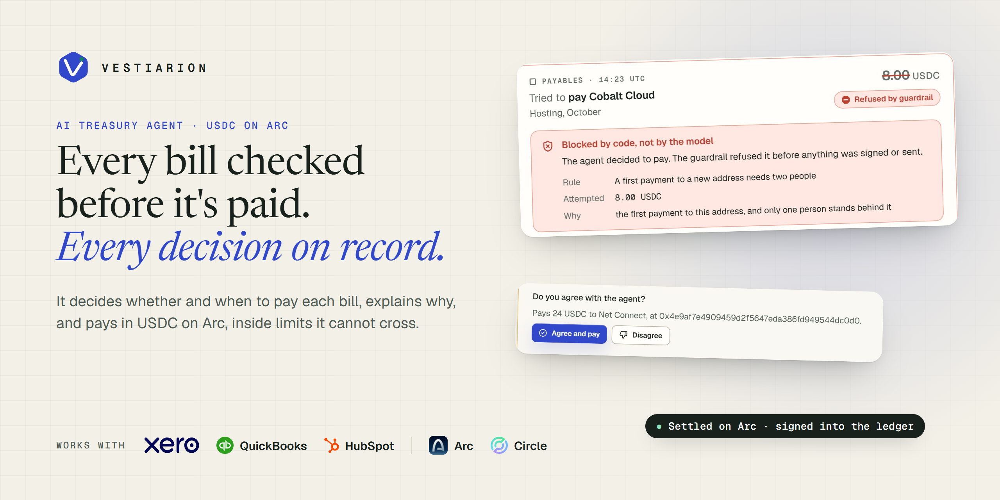
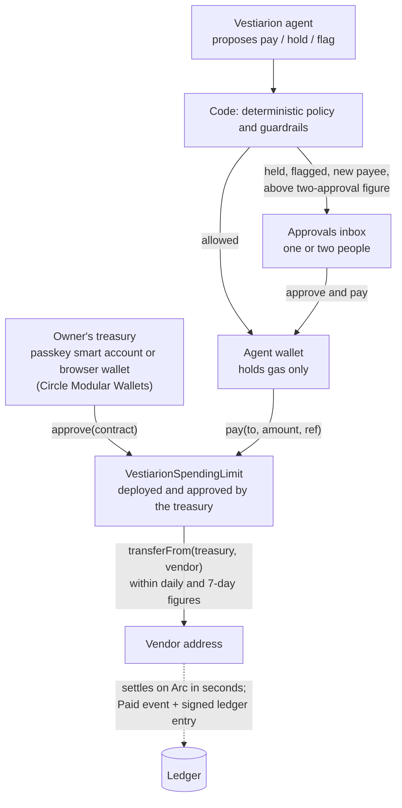
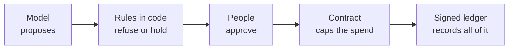

<div align="center">



# Vestiarion

**Your AI agent for bills and payments, for small businesses: it checks every bill before it is paid, pays in USDC on Arc inside limits a contract enforces, and signs every decision into a ledger you can verify.**

[](https://github.com/duongnq2798/vestiarion/actions/workflows/ci.yml)
[](https://github.com/duongnq2798/vestiarion/releases)
[](https://www.npmjs.com/package/@vestiarion/sdk)
[](LICENSE)

<a href="https://www.vestiarion.xyz"></a>
<a href="https://youtu.be/9Tgl1eMhlbw"></a>
<a href="https://chromewebstore.google.com/detail/vestiarion-invoice-captur/jfhjgbdbolhnneomgifdnjamoldlioan"></a>
<a href="https://www.npmjs.com/package/@vestiarion/sdk"></a>

**[See your first decision](https://www.vestiarion.xyz/docs/guides/try-it)** · **[Open numbers](https://www.vestiarion.xyz/open)** · **[Mainnet proof](#mainnet-proof)** · **[Docs](https://www.vestiarion.xyz/docs)** · **[MCP server](https://www.vestiarion.xyz/docs/ai-integration/mcp)** · **[Security](https://www.vestiarion.xyz/security)**

<sub>Built on [Arc](https://www.arc.io) and [Circle](#circle-integrations) · Works with [Xero](https://www.vestiarion.xyz/docs/guides/xero) · [QuickBooks Online](https://www.vestiarion.xyz/docs/guides/quickbooks) · [Zoho Books](https://www.vestiarion.xyz/docs/guides/zohobooks) · [HubSpot](https://www.vestiarion.xyz/docs/guides/hubspot) · [Pipedrive](https://www.vestiarion.xyz/docs/guides/pipedrive) · [Zoho CRM](https://www.vestiarion.xyz/docs/guides/zohocrm) · [BlindPay](https://www.vestiarion.xyz/docs/guides/bank-payouts) · [Asana](https://www.vestiarion.xyz/docs/guides/asana) · [GitHub](https://www.vestiarion.xyz/docs/guides/github) · [Slack](https://www.vestiarion.xyz/docs/guides/slack) · [Telegram](https://www.vestiarion.xyz/docs/guides/telegram) · [Chrome](https://www.vestiarion.xyz/docs/guides/invoice-capture) · [@vestiarionhq](https://x.com/vestiarionhq)</sub>

</div>

Vestiarion runs a small business's money cycle with one agent: it screens counterparties, pays vendors, releases
contractor pay, collects receivables and keeps idle cash working. A model proposes each action; ordinary code decides
whether it may happen; a person decides what code sends to them; and on Arc mainnet, when the treasury is the owner's
own wallet, the money itself can only leave through a spending-limit contract that wallet deployed. Every outcome, refusals included, is signed into a
hash-chained ledger anyone in the workspace can verify.

**Watch it work:** [the demo](https://youtu.be/9Tgl1eMhlbw) (2:59) or [the full product tour](https://youtu.be/ds6cu4__1J4)
(7:22), both recorded on the live product on October 15, 2026, with the Arc mainnet payment from October 12: a freelancer
the agent pays on its own once a second member confirmed the address, a new supplier's first bill the model wanted to pay
and code refused until a second member approved, the day the agent picks to pay, shadow mode and the customers' figures,
Arc mainnet and the proof. The tour opens how the agent decided, line by line, on three of those decisions.

> *Tameion* is ancient Greek for a treasury, the room the money was kept in. In Byzantium that room grew into the
> *vestiarion*, the department that minted the coin, held the stores and paid the army.

## Contents

- [How to evaluate Vestiarion in 5 minutes](#how-to-evaluate-vestiarion-in-5-minutes)
- [Watch each flow](#watch-each-flow)
- [What Vestiarion does](#what-vestiarion-does)
- [Why it is different](#why-it-is-different)
- [How payments work](#how-payments-work)
- [Safety architecture](#safety-architecture)
- [Arc mainnet and Arc testnet](#arc-mainnet-and-arc-testnet)
- [Product capabilities](#product-capabilities)
- [Integrations](#integrations)
- [Primitives for Arc builders](#primitives-for-arc-builders)
- [Quick start](#quick-start)
- [Verifiable activity](#verifiable-activity)
- [Documentation](#documentation)
- [Development](#development)
- [License](#license)

## How to evaluate Vestiarion in 5 minutes

Everything below runs on the live app, **[www.vestiarion.xyz](https://www.vestiarion.xyz)**, with an email address and
nothing else: no wallet, no USDC, no API key, nothing to install.

1. **Open a workspace on Arc testnet.** Sign in at [www.vestiarion.xyz/login](https://www.vestiarion.xyz/login) with
   **Continue with Google** or **Email me a sign-in link**, give the workspace a name and choose **Create workspace**
   (a **Test workspace**, on Arc testnet, if you are asked). It starts as a sandbox: payments are simulated and nothing
   reaches a chain.
2. **Load sample data and run the agent.** On **Treasury**, the console, choose **Load sample data**: six
   counterparties, eight invoices (seven to pay and one to collect) and two contractor milestones, chosen so that one cycle
   shows every outcome. Then choose **Run cycle now**. To try one of your own bills instead, follow
   [See your first decision](https://www.vestiarion.xyz/docs/guides/try-it).
3. **Read the decisions and the refusals.** On **Bills & receivables**, each bill shows what the agent decided: pay it,
   pay it on its discount's last day, ask for a missing purchase order, hold it above its supplier's limit, or flag it as
   a duplicate. Its card shows **Agent’s reasoning** and **How the agent decided**. Where the model wanted to pay and a
   rule in code stopped it, the card says "Blocked by code, not by the model" and names the rule.
   [How payments are controlled](https://www.vestiarion.xyz/docs/guides/controls) lists every rule, and
   [When the model and the policy disagree](https://www.vestiarion.xyz/docs/research/model-vs-policy#code-refused-seven-payments)
   shows the payments code refused in production.
4. **Verify the signed ledger.** Open **Audit log** and choose **Verify hash chain**: it checks every Ed25519 signature
   and hash link and answers "Chain intact". Under **Download**, **Signed JSON** exports the chain, and
   [`verify-ledger-export.mjs`](https://www.vestiarion.xyz/tools/verify-ledger-export.mjs) checks it on your own machine
   with Node.js alone ([Verify an audit export](https://www.vestiarion.xyz/docs/guides/audit-export)).
5. **Check production.** [Open numbers](https://www.vestiarion.xyz/open) reads production on every load: workspaces,
   payments, decisions and what code refused, per network, with our own payments linked to the explorer under "Verify it
   yourself". [Mainnet proof](#mainnet-proof) walks through the first payment on Arc mainnet: held by code as a first
   payment to a new address, approved by a second person, and paid through the owner's spending-limit contract.

**Watch instead:** [the demo](https://youtu.be/9Tgl1eMhlbw) (2:59),
[the full product tour](https://youtu.be/ds6cu4__1J4) (7:22), and [a short video for each main flow](#watch-each-flow),
two minutes or less each.

**Reviewing security:** [www.vestiarion.xyz/security](https://www.vestiarion.xyz/security) covers the architecture,
tenant isolation, encryption, access control, connector tokens, webhooks, the subprocessors and what we do not claim.
[SECURITY.md](SECURITY.md) says how to report a vulnerability.

**Where things are in this repository:**

| Path | What it holds |
| --- | --- |
| [`src/app`](src/app) | The Next.js routes: public pages, the workspace (`o/[slug]`), the shared links (`receipt`, `pay`, `report`, `statement`) and the API (`api/v1`, `api/mcp`) |
| [`src/lib`](src/lib) | The logic: the agent and the rules in code (`agent/`, `agent/guardrails.ts`), the signed ledger (`ledger.ts`), Circle and Arc (`circle/`), the connectors, the tenant data access layer (`dal/`) and secrets (`secrets.ts`) |
| [`src/components`](src/components) | The interface |
| [`supabase/migrations`](supabase/migrations) | The Postgres schema, row-level security and database functions, as numbered migrations |
| [`contracts`](contracts) | `VestiarionSpendingLimit` and `VestiarionEscrow`, in Solidity |
| [`sdk`](sdk) and [`cli`](cli) | `@vestiarion/sdk` and `@vestiarion/cli`: the TypeScript client and the `vestiarion` command |
| [`integrations`](integrations) | The Slack app manifest and the HubSpot app project |
| [`extensions`](extensions) | Vestiarion Invoice Capture, the Chrome extension that sends an invoice from the browser as a draft, with its store listing |
| [`content/docs`](content/docs) | The docs site's pages, in MDX |
| [`scripts`](scripts) | Operator commands: migrations, a cycle, the payments switch, contract builds, research replays |
| [`tests`](tests) | The Vitest suite `npm run verify` runs, every migration included, on an in-process Postgres |
| [`docs`](docs) | Running it yourself, releasing, and each feature's design with its rollout record |

## Watch each flow

One short video for each main flow, recorded in the live product on Arc testnet with demo data in the team's own workspaces. Each plays at the top of its guide, with its transcript, and on YouTube.

| Flow | Length | What it shows | YouTube |
| --- | --- | --- | --- |
| [See your first decision](https://www.vestiarion.xyz/docs/guides/try-it#watch-it) | 1:46 | A supplier and one of its bills added in shadow mode, the agent's decision and why, and a verdict. | [Watch](https://youtu.be/NLbkL9UTZno) |
| [Your first payment, paid by the agent](https://www.vestiarion.xyz/docs/guides/first-payment#watch-it) | 1:32 | A bill the agent pays on its own, one that waits for a second person, and the record of both. | [Watch](https://youtu.be/36goTq5mDVg) |
| [Shadow mode on your own bills](https://www.vestiarion.xyz/docs/guides/shadow-mode#watch-it) | 1:33 | Shadow mode on, test USDC for your real amounts, a mirror address, and a verdict on each decision. | [Watch](https://youtu.be/juD26mVxNCo) |
| [How payments are controlled](https://www.vestiarion.xyz/docs/guides/controls#watch-it) | 1:25 | A payment code refused, the limits, the people who approve, and the pause. | [Watch](https://youtu.be/Gftnox42XPA) |
| [Take a workspace live on Arc](https://www.vestiarion.xyz/docs/guides/go-live#watch-it) | 1:26 | Wallets created, funded with testnet USDC and taken live, then a workspace on Arc mainnet. | [Watch](https://youtu.be/AOPJduY0ohs) |
| [Get paid by a customer on Arc](https://www.vestiarion.xyz/docs/guides/collections#watch-it) | 1:05 | An invoice to a customer, its pay link and pay page, and the agent's next step on Collections. | [Watch](https://youtu.be/NHRKTiQvCEg) |
| [Early-payment offers made by the agent](https://www.vestiarion.xyz/docs/guides/early-payment-offers#watch-it) | 1:13 | The bills worth paying early, an offer the agent made and the supplier accepted, and a counter. | [Watch](https://youtu.be/GSrdfUdPoxU) |
| [Pay a contractor for verified work](https://www.vestiarion.xyz/docs/guides/pay-a-contractor#watch-it) | 1:01 | A freelancer paid through a one-time link, released by the agent, and milestone escrow. | [Watch](https://youtu.be/MQWOlUDi_h0) |
| [Bills from QuickBooks and Zoho Books](https://www.vestiarion.xyz/docs/guides/quickbooks#watch-it) | 1:00 | Open bills from QuickBooks and Zoho Books, reviewed and added, then decided by the agent. | [Watch](https://youtu.be/EhlpGMueECc) |
| [Bills that arrive on their own](https://www.vestiarion.xyz/docs/guides/import-bills#watch-it) | 1:17 | An invoice PDF read into the form, a pasted list of bills, and the email and Chrome intake. | [Watch](https://youtu.be/7ZxrTg0ZHGg) |
| [Pay a vendor's bank account in pesos](https://www.vestiarion.xyz/docs/guides/bank-payouts#watch-it) | 1:01 | Bank payouts set up with BlindPay, the vendor's bank account, and a payout followed to the end. | [Watch](https://youtu.be/ukbASJof93w) |
| [Evidence and the audit export](https://www.vestiarion.xyz/docs/guides/evidence#watch-it) | 0:56 | Why a payment was made, how each fact is known, and the audit log's chain check. | [Watch](https://youtu.be/CWGIqRzS_jg) |
| [Bills from Xero, decided by the agent](https://www.vestiarion.xyz/docs/guides/xero#watch-it) | 1:52 | Bills from the Xero Demo Company come in, one paid in Xero is caught before it is paid twice, and one is paid on Arc testnet. | [Watch](https://youtu.be/tobwyhBOZyU) |
| [A deal from HubSpot, collected on Arc](https://www.vestiarion.xyz/docs/guides/hubspot#watch-it) | 1:55 | A deal won in HubSpot is planned, its deposit is paid and matched, and the receipt is written back to HubSpot. | [Watch](https://youtu.be/m6BldH7aKkY) |

## What Vestiarion does

A small business pays vendors, contractors and recurring bills through several tools a person stitches together by
hand, and checks none of it continuously. Vestiarion replaces that with one decision loop, the **agent cycle**, that
reads the whole book each time it runs:

| Area | What the agent does |
| --- | --- |
| **Payables** | Three-way match (purchase order, goods received, invoice), duplicate and risk checks, then **pay**, **schedule**, **hold**, **request info** or **flag as fraud**, with its reasoning attached; checks scheduled bills against the cash ahead, chooses which bills get the cash first when it cannot cover them all, and, when turned on, asks a supplier for more time on a bill it cannot pay |
| **Contractors** | Releases a milestone once its evidence is verified, such as a merged GitHub pull request; on Arc testnet the milestone's USDC can sit in an escrow contract until then |
| **Compliance** | Re-screens every counterparty each cycle (OpenSanctions where configured) and tiers its payment limit down on a hit, reversibly. Checks every payout address against the addresses on OFAC's SDN list: the agent and people are refused one on it |
| **Receivables** | A signed deal becomes a schedule of receivables released on their days; a client pays through a link; the agent matches the transfer to what was owed, suggests how to apply a payment that covers several invoices, part of one or falls a fee short, and, when turned on, sends reminders for what is still owed within bounds code sets, after weighing what the customer said, paid and was promised, its own rules and the HubSpot deal it was sold through, asking a person first when the step is theirs; and, when turned on, while bills are held for want of cash, offers customers a small discount to pay an open invoice within 5 days |
| **Treasury** | On Arc testnet, sweeps idle cash above a 7-day buffer into Circle's USYC only when the yield beats the round-trip fee, and redeems ahead of what falls due |
| **Audit** | Appends every decision, human action and system event to an Ed25519-signed, hash-chained ledger, exportable and verifiable in one click |

The agent cycle: reconcile -> receipts -> compliance -> follow-up -> recurring -> services -> liquidity -> AP ->
contractors -> treasury -> forecast -> proposals -> collections -> early offers -> customer offers -> term requests ->
cash alert -> notices -> telegram -> slack, each stage's outcome appended to the ledger.

## Why it is different

- **The model argues; it cannot pay.** Anthropic, OpenAI or DeepSeek returns a structured
  `{action, reasoning, confidence}`. Code re-checks every hard rule after the model decides and before money moves, and
  with no model key at all a transparent rule-based policy takes the model's place. Every ledger entry records which one
  decided, and the written policy's answer is recorded beside the model's
  ([research: when the model and the policy disagree](https://www.vestiarion.xyz/docs/research/model-vs-policy)).
- **The limit is on the money's path, not only in the code.** On Arc mainnet a workspace can pay from a wallet its
  owner holds. The agent's wallet can only call `pay` on a contract that wallet deployed, which refuses anything past
  the daily or 7-day figure, whatever Vestiarion's code decided.
- **Vestiarion does not hold that treasury's USDC.** On that path the USDC stays in the owner's wallet or passkey
  smart account; Vestiarion holds no key to it, and the agent's wallet holds only gas. (Other setups differ; see
  [Custody, by setup](#custody-by-setup).)
- **People decide what matters.** A first payment to a new address, a payment above the two-approval figure, and
  anything the agent held all wait for a person, and some for two.
- **Figures are read, not asserted.** [Open numbers](https://www.vestiarion.xyz/open) is queried from the production
  database on every load, with Arc mainnet and Arc testnet counted apart and our own workspaces counted apart from
  customers'.

## How payments work

On Arc mainnet, a workspace whose treasury is its owner's wallet pays like this:



In words:

1. **The owner's wallet is the treasury.** In **Go live** the owner either connects a browser wallet (MetaMask,
   Rabby…) or creates a passkey wallet: a Circle smart account on Arc mainnet owned by their passkey, with an optional
   recovery address. The owner's wallet deploys the workspace's `VestiarionSpendingLimit`, approves it on USDC and
   sends the agent's wallet its gas; with a passkey that is one confirmation, after the browser checks every call
   against what it built itself.
2. **The agent proposes.** Each cycle the model reads the invoice, the counterparty's screening, the match and the cash
   position, and proposes an action with its reasoning.
3. **Code decides.** Duplicate, risk, payment-limit, three-way-match, new-payee, spending-limit and liquidity rules run
   as ordinary code. They can overrule the model; nothing the model writes can overrule them.
4. **A person decides what code sends them,** in the approvals inbox (or from Slack on Arc testnet). A person's
   approval goes through the same payment step the agent uses.
5. **The contract decides last.** The agent's wallet calls `pay(to, amount, ref)`. The contract pulls USDC from the
   treasury to the vendor only within the daily and 7-day figures, and never twice for the same `ref`. Only the owner's
   wallet can change the figures (`setLimits`), or stop the agent by setting its approval to 0.
6. **Arc settles; the ledger records.** Payment status is read back from Circle and the chain, the fee from the
   receipt (Arc's gas token is USDC, so the receipt is the dollar cost), and the outcome is signed into the ledger.

On Arc testnet the same decision path pays from Circle wallets instead, through the same contract once an owner or admin
turns on **Enforce on Arc**.

### Custody, by setup

| Setup | Where the USDC sits | Who can move it |
| --- | --- | --- |
| **Arc mainnet, your own wallet or passkey** | The owner's wallet | The owner; the agent only through the contract, within its figures |
| **Your own Circle account** (testnet or mainnet) | Developer-Controlled Wallets in the customer's Circle account | Vestiarion, with the API key and entity secret the owner pasted, stored encrypted |
| **Hosted testnet wallet** | Wallets in Vestiarion's own Circle testnet account | Vestiarion (Arc testnet only) |

## Safety architecture



| Layer | What it guarantees |
| --- | --- |
| **Guardrails in code** | Never pay a counterparty screened high risk, above its limit, a duplicate of a settled invoice, or with an incomplete match. A refusal records the model's argument and the rule that overruled it |
| **New-payee check** | The first payment to a payee at an address needs two people behind it: the agent never makes one that only the person who gave the address stands behind, and that person cannot approve it either. Whoever creates a payee link counts as having given the address the payee sends, read from the link's signed ledger entry, or from the link's own record when that entry is missing. For an address sent on GitHub, or one no member can be named as having given, no confirmation counts as the second person: one member confirms it and a different one approves its first payment, and no one approves it alone before another member has confirmed it. The agent asks the same before it sends a payment again whose earlier send was never recorded, so an address changed while a payment waited does not slip past it |
| **Payee lock** | Opt-in. A changed payout address is paid only once someone other than whoever entered it records how they checked it, with a contact the workspace had before the change, and, if the owner sets one, after a wait of 4 to 72 hours. Approving a payment never confirms its address. An address that matches or looks like another payee's, or like one the same payee had before, is flagged |
| **Two approvals** | Above a figure the owner sets, a payment needs two different people. Arc mainnet workspaces start at 100 USDC, and the owner can raise it but not turn it off there |
| **Maker and checker** | Roles are owner, admin, approver, viewer and accountant, who books and reads but decides no payment. No one approves an invoice they created; only Compliance clears a high-risk counterparty |
| **Agent spending limit** | A daily and a 7-day figure, checked in code and, where enforced, by the contract. Arc mainnet workspaces start at 50 USDC a day and 150 USDC in 7 days |
| **Project budgets** | A bill or milestone in a project has its money set aside in the project's budget, under a database lock, before the agent pays or schedules it; one the budget cannot cover waits for a person. An earmark in Vestiarion, never money locked on chain. A bill and a milestone for the same purchase order or delivered work are one obligation: the second waits for a person |
| **Try a limit first** | A new payment limit, two-approvals figure or spending limit can be tried on the agent's past 30 or 90 days of decisions: the code's checks replayed on what each recorded, in order, with no model call. Applying it is the setting's own change, refused if the setting moved since, and its signed entry records the replay |
| **Exactly once** | A database claim makes one decision exclusive; an idempotency key keyed on the invoice keeps a payment from leaving twice; the contract refuses a repeated `ref` |
| **Stop switches** | Anyone who can approve can pause the agent for the workspace; an owner's wallet can stop the contract; an operator can stop every payment on every deployment within 10 seconds |
| **Audit trail** | Every entry is Ed25519-signed and covers the hash of the one before. The verifier names the first entry that breaks; signed webhooks push each entry as it is written |
| **Shadow mode** | On Arc testnet a business keeps paying its bills itself, a person agrees or disagrees with each agent decision, and only agreed payments are made. What the business really paid is recorded beside each decision, never guessed |

The contract source is in [`contracts/`](contracts). It was written for Vestiarion and has not been audited.

## Arc mainnet and Arc testnet

Each workspace lives on one network, chosen when it is created, and never moves.

| | Arc testnet | Arc mainnet |
| --- | --- | --- |
| **Who can use it** | Anyone who signs in | Anyone who signs in at vestiarion.xyz; a self-hosted deployment chooses who with `MAINNET_ALLOWLIST` |
| **Money** | Testnet USDC and EURC from Circle's faucet | Real USDC, sent on Arc or brought from another chain through CCTP |
| **Treasury** | Hosted wallet, or your own Circle account | Your own wallet or passkey wallet, or your own Circle account |
| **Spending-limit contract** | Opt-in, deployed through Circle's Smart Contract Platform | Deployed by the owner's wallet on the own-wallet path |
| **Also available** | USYC reserve, milestone escrow, EURC swaps, CCTP and Gateway payouts to other chains, x402, shadow mode | USDC on Arc, and CCTP payouts to Base; features Arc mainnet lacks are not shown |

### Mainnet proof

On **Oct 7, 2026** a workspace we run made its first payment on Arc mainnet, from a passkey wallet, through its
spending-limit contract:

1. The owner's passkey wallet deployed and approved its contract in one transaction, with figures of 50 USDC a day and
   150 USDC in 7 days: [`0xe6261540…a9bb`](https://explorer.arc.io/tx/0xe62615407f44383d52a470574a877069e7e0114c2a074cc112149b3ab3efa9bb).
2. The agent decided to pay a 0.10 USDC invoice. Code held it: a first payment to a new address
   (`counterparty.new_payee`).
3. A second member, an admin, approved and paid it. The agent's wallet called the contract, which moved 0.10 USDC
   from the passkey treasury to the vendor and emitted `Paid`; fee 0.0035 USDC, confirmed in under a second, in block
   24,710,870 at 09:43:13 UTC:
   [`0xcecef38e…dee6`](https://explorer.arc.io/tx/0xcecef38e3f751bc118f8f00cee5bb5344679e84f89123d679b986b47d7f1dee6).

Contract: [`0xd90cA89Fc318d0330Bb14eaeF78B72C3CA7E7fB6`](https://explorer.arc.io/address/0xd90cA89Fc318d0330Bb14eaeF78B72C3CA7E7fB6).

On **Oct 19, 2026** two of our own test workspaces, not customers, made the first payouts from Arc mainnet to Base.
Each paid 1 USDC to a wallet on Base through CCTP V2, with Circle's Forwarding Service minting it there, the CCTP fee
on top. In both, the agent read the live CCTP fee and chose to pay on the due date: the bill offered no early-payment
discount, so keeping the cash until then cost nothing. Code then held it as a first payment to a new address, and the
workspace's only approver approved it.

- From a workspace's own Circle account
  ([#453](https://github.com/duongnq2798/vestiarion/pull/453)): the burn on Arc,
  [`0x89f66f7b…17e9`](https://explorer.arc.io/tx/0x89f66f7b618915e4e147c92dd175ba54a3fad8f8f5c689b616f3e552601617e9),
  and the mint on Base,
  [`0x33b0f0e5…f0ac`](https://basescan.org/tx/0x33b0f0e5ebd3422a999bfd31ad913033d6396b54a9817e9c7eba1621ee7df0ac).
- From the owner's passkey wallet, through version 2 of the spending-limit contract: the agent's gas-only wallet
  called `payAcrossChains`
  ([#454](https://github.com/duongnq2798/vestiarion/pull/454)), which took the payment and its fee from the passkey
  wallet and burned them on Arc,
  [`0x7c3b4b6b…2a17`](https://explorer.arc.io/tx/0x7c3b4b6b2561ca3d3dc0cd15594d7e0e8a9fd6717113e996a14acb243e642a17),
  and the mint on Base,
  [`0x9ea0fe5a…150c`](https://basescan.org/tx/0x9ea0fe5aa1b57f799595a48f336d1e008971e9a1d067dac1707ce02ff656150c).

Arc mainnet has no customer workspace yet; [Open numbers](https://www.vestiarion.xyz/open) shows the current count.

### Proof on Arc testnet

Made by the agent in production:

- a USDC payable paid 53 seconds after it was added, with no one pressing Run:
  [`0x81381c50…4e68`](https://explorer.testnet.arc.io/tx/0x81381c50f5d0cadb49d1af77f1abb06c1727c8377aa88cbe1cfbf327f09c4e68);
- a payment through the spending-limit contract, within its daily figure:
  [`0xa79cb982…e71e`](https://explorer.testnet.arc.io/tx/0xa79cb982c488d5c8d40cfc6b6141bf30d95f5615e580d3c3d6b55b779fe6e71e);
- a EURC invoice, weighed against a USDC limit at a rate quoted by Circle's Stablecoin Service:
  [`0x2e66257f…8f58`](https://explorer.testnet.arc.io/tx/0x2e66257f2cf478ecd2d0f7e263e1ad78bf9877b0afb93f3679c0601ef7328f58);
- a payout to Base Sepolia through CCTP: the burn on Arc,
  [`0xbc1961bb…d49c`](https://explorer.testnet.arc.io/tx/0xbc1961bbe2896e7e91d452498b595f1a1de8d45f34b7db8b3fd9d873d908d49c),
  and the mint Circle forwarded,
  [`0x6c749323…ef9a`](https://sepolia.basescan.org/tx/0x6c749323f9e36efe21fcd5c33df2e55ba5db82040dbd06ff2a8872045c6fef9a);
- an invoice read from a PDF by the model, checked by a person, and paid 16 seconds after it was added:
  [`0x197e979f…64b3`](https://explorer.testnet.arc.io/tx/0x197e979f3b108d759f5e5e5ee0d7bc67e67acb1c520de1b3c7e969ae689c64b3);
- idle cash into Circle's USYC through its Teller,
  [`0x1cf65900…f42e`](https://explorer.testnet.arc.io/tx/0x1cf659007ce734a73908a705e2537a56065d87fd0f52571d7e67d0654b94f42e),
  then the missing 0.88 USDC redeemed for a bill due today,
  [`0x4b5186db…c7f2`](https://explorer.testnet.arc.io/tx/0x4b5186db4820df87532869e0a9797df5a79a7e9e3a5feb1e3edb09500160c7f2),
  and the bill paid 34 seconds after it was added,
  [`0x365da374…9d8b`](https://explorer.testnet.arc.io/tx/0x365da374f902fcb995643713962554b41e6114b62bb40695874aa519dd829d8b);
- with the cash short of two bills due the same day, the 50 USDC of database backups the agent chose to pay first,
  over a 30 USDC one-off migration the written policy put first,
  [`0x1adfad84…3a7b`](https://explorer.testnet.arc.io/tx/0x1adfad848f00fdadf7021ba1f1ac30505146c40c220eac8cbca36cfc479e3a7b);
- with the payee lock on, a vendor's payout address changed to a fresh wallet holding 0 USDC. The agent held its
  3 USDC bill while the address was unconfirmed. The member who entered the address could not confirm it, even with a
  full record. A second member confirmed it, and the agent then held the bill through the 4-hour wait. Only after
  that did it pay, and the wallet went from 0 to 3 USDC:
  [`0x49787501…0551`](https://explorer.testnet.arc.io/tx/0x49787501b6738cc2653bfb93a51293d4f036ff85a41115dc7f5b5f07db720551);
- the same in a workspace with one member. A record that did not say the contact was on file before the change was
  refused, and so was **Agree and pay** during the wait. Once the wait ended, the first payment to the new address still
  needed the approver:
  [`0x7948ea38…72c5`](https://explorer.testnet.arc.io/tx/0x7948ea3868fc4ea284b69c88b90b20aa728bc8592f809ce7477f1895282972c5).

Each feature's design under [`docs/superpowers/specs/`](docs/superpowers/specs) ends with its rollout record: what was
run in production, with its ledger entries and transactions.

## Product capabilities

- **AP automation** — invoices typed in, imported from a bill list in its own columns, dates and currency, read from a PDF, forwarded by email, captured
  from the browser with the Chrome extension, or sent through the API; recurring payables; early-payment discounts taken when they pay.
- **Approvals inbox** — approve and pay, reject, or return to the agent; claims keep two people from deciding the
  same row.
- **Try a limit first** — see which past bills a new payment limit, two-approvals figure or spending limit would have
  held or let through, then apply it from the result.
- **Contractor milestones** — verified by a merged pull request, by a person accepting the Asana task the work was
  delivered in, or by a person; GitHub bounties with `/bounty` and `/payto`; a pull request comment once paid.
- **Payee links** — a payee enters and confirms their own address, or creates a passkey wallet to be paid in.
- **Receivables** — pay links on Arc, matched receipts, payments applied to several invoices or part of one with the
  agent's suggestions, credit and fees kept apart, reversals appended, reminders for what is still owed that follow
  the customer's context (a dispute, a claim, a promise, its own rules, its HubSpot deal's owner), and a search by
  invoice number, id, purchase order, amount or transaction.
- **Customer statements** — a link per customer to a page of what it owes, where it can say it paid, promise a day or
  dispute an invoice; the agent's reminders wait while a promise or a dispute stands.
- **Commissions** — a sales partner or referrer earns only on money a customer actually paid on Arc, for exactly the
  amount applied; a person turns what is due into a payable the agent pays like any bill, and the partner never
  approves their own payout.
- **Deals** — a signed deal (a deposit and the balance, milestones, a retainer or custom lines) as a schedule that adds
  up to its total exactly; each line released as a receivable on its day, by a person or the agent; a price change or
  a cancel is a signed new version that never rewrites what was invoiced or paid.
- **Projects** — a budget and a buffer in USDC for each job, client or launch; its bills, milestones and deals, what
  is set aside, paid and still available, what its deals collected, and its days in the payment plan. The agent never
  sets aside the same money twice, and holds what a budget cannot cover for a person.
- **Treasury** — safe-to-spend today, cash outlook, USYC reserve with **Bring cash back** (Arc testnet).
- **Cross-currency and cross-chain** — EURC invoices and swaps, CCTP and Gateway payouts (Arc testnet), and CCTP payouts to Base from Arc mainnet.
- **Supplier payment status** — a link per supplier to a page of its own bills: where each one stands, from received to
  paid, with each payment's transaction on Arc, and never why a bill is held.
- **Early-payment offers** — the agent's later bills, each with the discount worth asking for paying today; an owner or
  admin sends the supplier a one-time link, or turns on the agent's own offers: it picks the bills and the discount up to
  a ceiling, only from cash it can pay today, and emails the supplier the link. An accepted offer is paid at the
  discounted amount the same day.
- **When the cash is short** — the agent checks each scheduled bill against the cash ahead and holds one it will not
  cover days early. When the bills due within 14 days come to more than the cash, the model orders them by what costs
  the business most to pay late, saying why for each, and code pays in that order only while the cash lasts. When
  turned on, it asks a supplier for more time on a bill it cannot pay, answers a supplier who proposes fewer days, and
  takes the request back once the cash is there; and it offers customers a small discount to pay sooner. It tells the
  owner how much is needed and by when, in the console, Telegram and Slack.
- **Weekly brief** — on Mondays, owners, admins and approvers get the week by email: what was paid and received, the
  decisions, what waits for them, what leaves next, and whether the cash covers the next 30 days. In shadow mode it
  reports the verdicts instead, and how often the business agreed with the agent.
- **Bank payouts** — a vendor's bills paid to its bank account in Mexico, in pesos over SPEI through BlindPay, from the
  workspace's USDC; a person sees what the vendor receives and approves every one (BlindPay's development instance).
- **Shadow mode** — try the agent on real bills, paid in the business's own way, before it pays anything itself.
- **Report** — what the agent did with a workspace's real bills: payments with their transactions, what it stopped
  and why, how often a person stepped in, discounts measured from the transfers, and what is left before a live slice,
  which an owner then opens on Arc mainnet with the vendors they choose, carried over without typing them in again.
  Agent vs what really happened lays each bill's decision beside what the business recorded paying outside
  Vestiarion, one bill at a time, from a CSV, or from a bank statement whose lines are matched to the bills they could
  have paid, each figure linked to its signed entry. Value keeps measured, estimated and not-counted figures apart, and
  an owner or admin can share a live copy by a revocable link, with suppliers as labels and amounts hidden if they
  choose.
- **Workspaces and members** — per-network workspaces, invitations, five roles, per-member notifications; an
  accountant console across the businesses an outside accountant looks after.
- **When a payment does not settle** — each exceptional state says who acts, what Vestiarion already did and what to do
  next; paying again always looks for the earlier transfer first.
- **Why it was paid** — one page per payment, link by link from the purchase order to the receipt, each fact marked
  checked by code, verified outside or stated by a person; entries checked again in the browser, and a JSON download.
- **Audit** — the signed ledger, one-click verification, exports, and signed webhooks.

## Integrations

### Circle integrations

| Circle product | Used for |
| --- | --- |
| **Developer-Controlled Wallets** | Treasury and agent wallets, transfers, balances, confirmation |
| **Modular Wallets** | Passkey smart accounts: the owner's treasury on Arc mainnet, and a payee's wallet |
| **Smart Contract Platform** | Deploying the escrow and spending-limit contracts on Arc testnet |
| **Gas Station** | Paying the agent wallet's gas on Arc testnet |
| **USYC** | The yield-bearing reserve, through its Teller (Arc testnet) |
| **CCTP V2** and **Gateway** | Paying payees on other chains: through CCTP and Gateway on Arc testnet, where Gateway also settles x402 purchases, and through CCTP to Base from Arc mainnet |
| **CCTP V2 Forwarding Service** | Adding USDC to a workspace's wallet on Arc from Base, Ethereum and other chains, minted by Circle so the wallet needs no gas (both networks) |
| **Stablecoin Service** | EURC quotes and USDC→EURC swaps (Arc testnet) |
| **Notifications** | Settlement and incoming-transfer webhooks, recorded within seconds |

### Team and developer tools

| Surface | What it does |
| --- | --- |
| **[Slack](https://www.vestiarion.xyz/docs/guides/slack)** | Decisions in a channel; `/vestiarion today`, `waiting`, `ledger`; Approve and pay, Reject and Return buttons on Arc testnet within a limit; add an invoice from a message |
| **[Telegram](https://www.vestiarion.xyz/docs/guides/telegram)** | Each member's own chat: decisions with reasons, `/today`, `/waiting`, `/ledger`, invoices read from a PDF. The bot never approves or pays |
| **[REST API](https://www.vestiarion.xyz/docs/api)** | `/api/v1` with per-member keys: read everything, and with write access add counterparties, invoices, milestones and payee links. A key never approves or pays |
| **[TypeScript SDK](https://www.vestiarion.xyz/docs/get-started/sdk)** | [`@vestiarion/sdk`](https://www.npmjs.com/package/@vestiarion/sdk): a typed client for every `/api/v1` operation, plus webhook and ledger verification |
| **[CLI](https://www.vestiarion.xyz/docs/get-started/cli)** | [`@vestiarion/cli`](https://www.npmjs.com/package/@vestiarion/cli): the `vestiarion` command for every `/api/v1` operation, asking before each write, plus offline checks of audit exports and webhook signatures |
| **[Postman](https://www.vestiarion.xyz/docs/get-started/postman)** | A Getting Started collection, from a key to a first call and a first write, and an API reference collection with every `/api/v1` operation, both generated from the OpenAPI document and served at `/postman/` |
| **[MCP server](https://www.vestiarion.xyz/docs/ai-integration/mcp)** | `/api/mcp`, whose tools are the `/api/v1` operations, for AI agents; [`server.json`](server.json) describes it for the MCP Registry |
| **[Webhooks](https://www.vestiarion.xyz/docs/webhooks)** | Up to 5 HTTPS endpoints per workspace receive every ledger entry, signed, with retries |
| **[GitHub](https://www.vestiarion.xyz/docs/guides/github)** | Milestone verification from merged pull requests, bounties, and payment comments |
| **[Email](https://www.vestiarion.xyz/docs/guides/email-invoices)** | A workspace address that reads forwarded invoices into drafts a person adds |
| **[Chrome extension](https://www.vestiarion.xyz/docs/guides/invoice-capture)** | Vestiarion Invoice Capture sends the invoice text you select on a page, or a file you choose, to your workspace as a draft: you check the fields it read and send it, and an owner or admin adds it as a bill through the same checks as any bill. It connects by signing in and allowing it, never with an API key, and can only create and read its own drafts: it never adds a bill, approves or pays. [Add it to Chrome](https://chromewebstore.google.com/detail/vestiarion-invoice-captur/jfhjgbdbolhnneomgifdnjamoldlioan) from the Chrome Web Store, or [download it](https://www.vestiarion.xyz/downloads/vestiarion-invoice-capture.zip) and load it unpacked, as the guide says. Its source is in [`extensions/chrome-invoice-capture`](extensions/chrome-invoice-capture) |
| **[Asana](https://www.vestiarion.xyz/docs/guides/asana)** | A milestone linked to the Asana task its work is delivered in is ready for acceptance when the task is completed; a person checks the deliverables against the criteria and accepts it, and the agent then decides its payment as for any verified milestone. A task completed in Asana is never by itself a reason to pay, and a task reopened or changed after acceptance is flagged |
| **[HubSpot](https://www.vestiarion.xyz/docs/guides/hubspot)** | Won deals come in with their customers every 15 minutes; Plan collections fills in the New deal form, and a deal changed in HubSpot afterwards is flagged on its deal for a person to change or keep; once allowed, each planned deal's receipts are written back to it (collected, still owed, last receipt, reconciliation), read back, never over a person's change; one account per workspace. [Watch it](https://www.vestiarion.xyz/docs/guides/hubspot#watch-it) (1:55) |
| **[Pipedrive](https://www.vestiarion.xyz/docs/guides/pipedrive)** | Won deals come in with their organizations and persons as soon as Pipedrive says a deal changed, and every 15 minutes; Plan collections fills in the New deal form, and a deal changed in Pipedrive afterwards is flagged on its deal for a person to change or keep; once allowed, each planned deal's receipts are written back to it in Vestiarion's own deal fields, read back, never over a person's change. Pipedrive names no developer sandbox, so only payments on Arc mainnet outside shadow mode are written; one company per workspace |
| **[BlindPay](https://www.vestiarion.xyz/docs/guides/bank-payouts)** | Bank payouts: a vendor given its CLABE has its bills paid to its bank account in Mexico, in pesos over SPEI, from the workspace's USDC on Arc. Only the bank and last four digits are kept; every payout is held for a person, who sees BlindPay's quote of what the vendor receives, and takes exactly the bill's amount or sends nothing. BlindPay's development instance in this version |
| **[Zoho CRM](https://www.vestiarion.xyz/docs/guides/zohocrm)** | Won deals come in with their accounts and contacts every 15 minutes, from the Zoho data center the account lives in (any but China's); Plan collections fills in the New deal form, and a deal changed in Zoho CRM afterwards is flagged on its deal for a person to change or keep; read-only, and several workspaces may connect the same organization |
| **[Xero](https://www.vestiarion.xyz/docs/guides/xero)** | Bills approved in Xero come in for review every 15 minutes, through the same check as a bill list, and become payables when a person adds them; once paid on Arc, each payment is drafted as a booking against its bill, which an owner or admin reviews field by field and approves before anything is written to Xero. A payment on Arc testnet or in shadow mode is booked only into a Xero demo company. [Watch it](https://www.vestiarion.xyz/docs/guides/xero#watch-it) (1:52) |
| **[QuickBooks Online](https://www.vestiarion.xyz/docs/guides/quickbooks)** | Open bills in QuickBooks come in for review every 15 minutes, and sooner when QuickBooks says one changed, through the same check; a bill partly paid there comes in at what is left; read-only, with the bank account payments will be booked to chosen ahead |
| **[Zoho Books](https://www.vestiarion.xyz/docs/guides/zohobooks)** | Open bills in Zoho Books come in for review every 15 minutes, through the same check, from the Zoho data center the account lives in (any but China's); a bill partly paid there comes in at what is left, and one paid or voided after it was added is flagged; a person with several organizations picks one; read-only, and a bill deleted in Zoho Books is not seen |

The Postman collections are also in a public workspace, [Vestiarion API](https://www.postman.com/vestiarion/vestiarion-api), and the MCP server is in the [MCP Registry](https://registry.modelcontextprotocol.io/v0.1/servers?search=io.github.duongnq2798/vestiarion) as `io.github.duongnq2798/vestiarion`.

```bash
npm install @vestiarion/sdk            # the typed client
npm install --global @vestiarion/cli   # the vestiarion command
```

The `vestiarion` command works with a workspace from a terminal, with a key from Settings → API keys:

```bash
vestiarion login                                            # asks for the key, checks it, saves it for your user
vestiarion bills list --status held                         # what the agent held; bills show <id> says why
vestiarion ledger verify vestiarion-acme-ledger-1042.json   # an audit export, checked offline
```

Operators of a deployment of their own also run the repository's scripts (`npm run cycle`, `npm run status`, …), listed
in [docs/self-hosting.md](docs/self-hosting.md#scripts).

## Primitives for Arc builders

Pieces of Vestiarion another Arc app can take as they are, under this repository's license. Each is tested on its own.

To fork just the two contracts and the ledger verifier, without the app, use
[duongnq2798/vestiarion-primitives](https://github.com/duongnq2798/vestiarion-primitives): a Foundry project with
both contracts byte for byte, a build that reproduces the Arc mainnet bytecode and a script that checks it against the
chain, unit, fuzz and invariant tests, deploy scripts, the deployment addresses, and viem examples for each call.

| Primitive | What it gives an Arc app | Where |
| --- | --- | --- |
| **`VestiarionSpendingLimit`** | An agent that pays from a treasury it does not hold. Only the agent's wallet calls `pay(to, amount, ref)`; it never passes a daily or a 7-day figure and never pays a `ref` twice. The treasury keeps its USDC and approves the contract, so the contract holds nothing; its owner changes the figures with `setLimits`, or stops the agent by approving 0. Runs on Arc mainnet: [`0xd90cA89Fc318d0330Bb14eaeF78B72C3CA7E7fB6`](https://explorer.arc.io/address/0xd90cA89Fc318d0330Bb14eaeF78B72C3CA7E7fB6). | [`contracts/VestiarionSpendingLimit.sol`](contracts/VestiarionSpendingLimit.sol), deploy and calls in [`src/lib/spending-limit/`](src/lib/spending-limit/), tested in an in-process EVM in [`tests/spending-limit-contract.test.ts`](tests/spending-limit-contract.test.ts) |
| **`VestiarionSpendingLimitV2`** | Version 2, which path C deploys since Oct 19, 2026: all of the above, and `payAcrossChains(amount, maxFee, domain, recipient, ref)`, which pays a vendor on Base through CCTP V2 from the same treasury, counting the amount and its fee against the same figures. The token messenger and the allowed domains are fixed at deployment, the fee is capped at 10% and 2 USDC, and the contract holds nothing after a call. Not audited. | [`contracts/VestiarionSpendingLimitV2.sol`](contracts/VestiarionSpendingLimitV2.sol), the upgrade in [`src/lib/treasury/contract-upgrade.ts`](src/lib/treasury/contract-upgrade.ts), tested in [`tests/spending-limit-v2-contract.test.ts`](tests/spending-limit-v2-contract.test.ts) |
| **`VestiarionEscrow`** | Milestone escrow in about 80 lines: the payer locks USDC for a payee, releases it, or takes it back from a set date. No owner, no upgrade. | [`contracts/VestiarionEscrow.sol`](contracts/VestiarionEscrow.sol), [`src/lib/circle/escrow-holds.ts`](src/lib/circle/escrow-holds.ts), [`tests/escrow-contract.test.ts`](tests/escrow-contract.test.ts) |
| **A signed decision ledger** | Every decision an agent makes, with the facts it saw, as an Ed25519-signed, hash-chained entry. Anyone verifies one entry or a whole chain, in a browser or offline from an export. | [`src/lib/ledger.ts`](src/lib/ledger.ts), [`verifyLedgerEntry`](sdk/src/webhooks.ts) in the SDK, [Verify an audit export](https://www.vestiarion.xyz/docs/guides/audit-export) |
| **Shadow mode** | A way to try an agent on a business's real bills without moving its money: each decision waits for a person's verdict, each agreed payment settles on Arc testnet at the real amount, the agreement rate is counted, and what the business really paid is recorded and compared bill by bill. | [`src/lib/shadow-mode.ts`](src/lib/shadow-mode.ts), [`src/lib/verdicts.ts`](src/lib/verdicts.ts), [`src/lib/actual-payments-compare.ts`](src/lib/actual-payments-compare.ts), [Shadow mode](https://www.vestiarion.xyz/docs/guides/shadow-mode) |
| **`@vestiarion/sdk`** | A typed client with no dependencies, plus webhook and ledger signature checks. | [`sdk/`](sdk/), [npm](https://www.npmjs.com/package/@vestiarion/sdk) |

**What these add to the circlefin/arc-\* samples.** The samples show how to move USDC on Arc: checkout, peer-to-peer
payments, a treasury across chains, an escrow released by an AI review, an agent paying for x402 services. An agent's
budget there, as in arc-nanopayments' `--limit`, is enforced by the agent's own process. Here the bound is a contract
on Arc that the agent's wallet cannot get past, while the treasury keeps custody. Each payment carries a signed record
of why it was made, and shadow mode measures how often people agree with the agent before it pays on its own.

## Quick start

**Use the hosted app** — no wallet or keys needed to start:

1. Sign in at [www.vestiarion.xyz](https://www.vestiarion.xyz) with your email and open a workspace on Arc testnet, in shadow mode.
2. Add a supplier and one of your bills, or load sample data, and watch the agent decide within a minute.
3. Agree or disagree with its decision, read the **Report** of what the agent did, then verify the signed ledger.

The whole path is in [See your first decision](https://www.vestiarion.xyz/docs/guides/try-it). To move testnet USDC,
follow [Go live](https://www.vestiarion.xyz/docs/guides/go-live) and fund the wallet from
[Circle's faucet](https://faucet.circle.com).

**Call the API** — create a key under **Settings**, then:

```bash
curl -H "Authorization: Bearer $VESTIARION_API_KEY" https://www.vestiarion.xyz/api/v1/status
```

See the [Quickstart](https://www.vestiarion.xyz/docs/get-started/quickstart) and
[Authentication](https://www.vestiarion.xyz/docs/get-started/authentication).

## Verifiable activity

- **[Open numbers](https://www.vestiarion.xyz/open)** — workspaces, payments, the agent's decisions, what code refused
  and what people decided, per network, customers apart from us, read from production on every load. Figures change
  daily, so this README links there instead of copying them.
- **The ledger** — every workspace's `/audit` verifies its whole chain in one click; exports and webhooks carry the
  same signed entries.
- **[Research](https://www.vestiarion.xyz/docs/research/model-vs-policy)** — three weeks of the model's decisions
  recorded beside the written policy's, including where code had to refuse it.

### Contracts on Arc testnet

Vestiarion's own contracts, the copies in our test workspace:

| Contract | Address |
| --- | --- |
| `VestiarionEscrow` | [`0x74af203fec3f121ff1cd3a763092d1211487702b`](https://explorer.testnet.arc.io/address/0x74af203fec3f121ff1cd3a763092d1211487702b) |
| `VestiarionSpendingLimit` | [`0x9da3c47f73ea9399ac566806a189b0bf47b7d4ba`](https://explorer.testnet.arc.io/address/0x9da3c47f73ea9399ac566806a189b0bf47b7d4ba) |

The Circle contracts it calls:

| Contract | Address |
| --- | --- |
| USDC | [`0x3600000000000000000000000000000000000000`](https://explorer.testnet.arc.io/address/0x3600000000000000000000000000000000000000) |
| EURC | [`0x89B50855Aa3bE2F677cD6303Cec089B5F319D72a`](https://explorer.testnet.arc.io/address/0x89B50855Aa3bE2F677cD6303Cec089B5F319D72a) |
| USYC | [`0xe9185F0c5F296Ed1797AaE4238D26CCaBEadb86C`](https://explorer.testnet.arc.io/address/0xe9185F0c5F296Ed1797AaE4238D26CCaBEadb86C) |
| USYC Teller | [`0x9fdF14c5B14173D74C08Af27AebFf39240dC105A`](https://explorer.testnet.arc.io/address/0x9fdF14c5B14173D74C08Af27AebFf39240dC105A) |
| USYC Entitlements | [`0xCC205224862C7641930c87679E98999d23C26113`](https://explorer.testnet.arc.io/address/0xCC205224862C7641930c87679E98999d23C26113) |
| Gateway Wallet | [`0x0077777d7EBA4688BDeF3E311b846F25870A19B9`](https://explorer.testnet.arc.io/address/0x0077777d7EBA4688BDeF3E311b846F25870A19B9) |
| Gateway Minter | [`0x0022222ABE238Cc2C7Bb1f21003F0a260052475B`](https://explorer.testnet.arc.io/address/0x0022222ABE238Cc2C7Bb1f21003F0a260052475B) |
| CCTP TokenMessengerV2 | [`0x8FE6B999Dc680CcFDD5Bf7EB0974218be2542DAA`](https://explorer.testnet.arc.io/address/0x8FE6B999Dc680CcFDD5Bf7EB0974218be2542DAA) |

What each one is for, the wallets around them, and the USDC of the chains payees are paid on:
[Contracts](https://www.vestiarion.xyz/docs/contracts).

## Documentation

| | |
| --- | --- |
| **Start** | [See your first decision](https://www.vestiarion.xyz/docs/guides/try-it) · [How payments are controlled](https://www.vestiarion.xyz/docs/guides/controls) · [Go live](https://www.vestiarion.xyz/docs/guides/go-live) · [Your first payment](https://www.vestiarion.xyz/docs/guides/first-payment) · [Shadow mode](https://www.vestiarion.xyz/docs/guides/shadow-mode) |
| **Guides** | [Payment plan](https://www.vestiarion.xyz/docs/guides/payment-plan) · [Where a payment is](https://www.vestiarion.xyz/docs/guides/where-a-payment-is) · [Workspace report](https://www.vestiarion.xyz/docs/guides/report) · [Try a limit first](https://www.vestiarion.xyz/docs/guides/try-a-rule) · [Pay a contractor](https://www.vestiarion.xyz/docs/guides/pay-a-contractor) · [Asana acceptance](https://www.vestiarion.xyz/docs/guides/asana) · [Invoice capture](https://www.vestiarion.xyz/docs/guides/invoice-capture) · [Get paid](https://www.vestiarion.xyz/docs/guides/get-paid) · [Customer statements](https://www.vestiarion.xyz/docs/guides/customer-portal) · [Supplier payment status](https://www.vestiarion.xyz/docs/guides/supplier-status) · [Commissions](https://www.vestiarion.xyz/docs/guides/commissions) · [When a payment does not settle](https://www.vestiarion.xyz/docs/guides/payment-exceptions) · [Accountants](https://www.vestiarion.xyz/docs/guides/accountants) · [Why a payment was paid](https://www.vestiarion.xyz/docs/guides/evidence) · [Cash scenarios](https://www.vestiarion.xyz/docs/guides/cash-scenarios) · [Deals](https://www.vestiarion.xyz/docs/guides/deals) · [Projects](https://www.vestiarion.xyz/docs/guides/projects) · [Audit export](https://www.vestiarion.xyz/docs/guides/audit-export) |
| **Developers** | [Quickstart](https://www.vestiarion.xyz/docs/get-started/quickstart) · [API reference](https://www.vestiarion.xyz/docs/api) · [SDK](https://www.vestiarion.xyz/docs/get-started/sdk) · [CLI](https://www.vestiarion.xyz/docs/get-started/cli) · [Postman](https://www.vestiarion.xyz/docs/get-started/postman) · [Webhooks](https://www.vestiarion.xyz/docs/webhooks) · [MCP](https://www.vestiarion.xyz/docs/ai-integration/mcp) · [Changelog](https://www.vestiarion.xyz/docs/changelog) |
| **This repository** | [ARCHITECTURE.md](ARCHITECTURE.md) · [Running it yourself](docs/self-hosting.md) · [Feature designs](docs/superpowers/specs) · [Contracts](contracts) · [SDK source](sdk) · [CLI source](cli) · [Changelog](CHANGELOG.md) · [Releases](https://github.com/duongnq2798/vestiarion/releases) · [Releasing](docs/RELEASING.md) · [Distribution](docs/distribution) |

## Development

Next.js, TypeScript, Supabase Postgres with row-level security, Vitest, Solidity 0.8.37.

```bash
npm install
cp .env.example .env.local   # Supabase URL and keys, VESTIARION_MASTER_KEYS, SUPABASE_JWT_SECRET
npm run db:migrate
npm run dev
```

You need a [Supabase](https://supabase.com) project (Project Settings → API for the URL and keys, the JWT secret
under JWT Keys). With no Circle or model keys, payments are simulated against Arc's measured fee and latency, and
decisions come from the rule-based policy, so the app runs end to end with no credentials.

```bash
npm run verify   # typecheck, lint and the full test suite: what CI runs
```

The suite needs no Supabase, Circle or model key: it covers the ledger's tamper cases, risk tiering, treasury
economics, guardrails and provider fallback, and runs every migration on an in-process Postgres (PGlite) to hold the
database's half of the hash chain to the verifier.

[docs/self-hosting.md](docs/self-hosting.md) covers the rest: environment variables, the founding workspace, every
script, going live per path, the scheduled jobs (Supabase Cron), Circle notifications, GitHub, and what is live versus
simulated.

## License

[MIT](LICENSE). Zoho, Zoho Books and Zoho CRM are trademarks of Zoho Corporation Pvt. Ltd. Arc, Circle, Slack, Telegram,
Xero, QuickBooks, HubSpot, Pipedrive, Asana and npm are trademarks of their respective owners; their names show what
Vestiarion is built on and connects to, not an endorsement.

<a href="https://www.producthunt.com/products/vestiarion?embed=true&utm_source=badge-featured&utm_medium=badge&utm_campaign=badge-vestiarion"></a>
